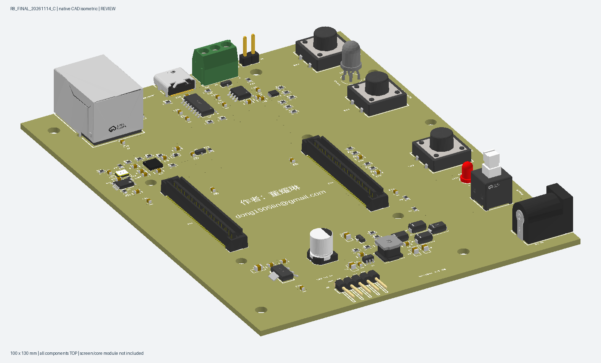

# InfraBot 4.3 Carrier Board

English · [简体中文](README.zh-CN.md)

**R8 engineering reference design.**

A four-layer carrier board for the **EmbedFire STM32H743 Challenger V2 core module** and a **4.3-inch display**, designed for a robot-control interface with Ethernet, CAN and accessible front-panel controls.

[**Schematics PDF**](docs/schematics/infrabot-pcb-4p3-R8-schematic.pdf) · [Editable hardware](hardware/infrabot_pcb_4p3/infrabot_pcb_4p3.eprj3) · [Manufacturing files](manufacturing/R8/) · [Assembly guide](docs/assembly.md)



*CAD preview. The core module, display and enclosure are not shown. Library models illustrate placement; actual component dimensions take precedence.*

## Highlights

- **100 × 130 mm**, nominally 1.6 mm thick, with a **Signal–Ground–Power–Signal** stackup.
- **Ethernet/RMII, CAN, USB-to-UART and SWD** connections.
- **POWER, RESET, STOP and RESUME** buttons, a power LED and an RGB status LED.
- Components on the **top side**, with connectors and controls arranged for enclosure access.
- Display and touch signals connect directly to the core module through a **40-pin FPC**.
- Editable schematics and PCB, complete **105-component BOM/CPL**, Gerber files and a custom formed-lead LED2 footprint/model.

## Hardware files

The current hardware revision is **R8**. Start with the PDF to inspect the circuit without installing an EDA application.

- [Schematics PDF](docs/schematics/infrabot-pcb-4p3-R8-schematic.pdf) — circuit drawings organized by function, with sheet bookmarks.
- [EasyEDA project](hardware/infrabot_pcb_4p3/infrabot_pcb_4p3.eprj3) — editable schematics, PCB and configuration.
- [Gerber ZIP](manufacturing/R8/Gerber.zip) — copper, mask, silkscreen, paste, outline and drill files.
- [Bill of materials](manufacturing/R8/BOM.csv) and [placement coordinates](manufacturing/R8/CPL.csv) — the complete design, without personal-order exclusions.
- [LED2 footprint and STEP model](hardware/library/) — including lead positions and model setup notes.

See the [manufacturing instructions](manufacturing/R8/README.md) for layer order, drill interpretation, assembly-side conventions and process requirements.

## Getting started

1. Read the [schematics](docs/schematics/infrabot-pcb-4p3-R8-schematic.pdf), [interfaces](docs/interfaces.md) and [assembly guide](docs/assembly.md).
2. Clone or download the complete repository, then open the native project in **EasyEDA Pro**. R8 was exported and checked with version **4.1.71**; preserve a backup before saving with another version.
3. Run the offline checks with **Python 3.10+**:

   ```bash
   python3 -B tools/verify.py
   python3 -B -m unittest discover -s tests -v
   ```

   These commands use only the Python standard library. They check delivered-file hashes, schematic/PCB pin networks, and BOM/CPL consistency.
4. Review the required external modules and assembly notes before fabrication. For design changes, follow the [re-export workflow](docs/reproduce.md).

To create a complete local release archive:

```bash
python3 -B tools/package_release.py
```

The ZIP and checksum are written to `.build/`. Existing output archives are preserved; choose a new filename with `--output` when needed.

The detailed assembly and interface guides are currently in Simplified Chinese.

## Compatibility and assembly

The core module, display, matching FPC, power supply and mounting hardware are supplied separately. The reference display configuration is **GL043056B0, 480 × 272**; confirm the actual module revision and connector orientation.

- **Power:** use **6–12 V DC**; do not connect a 24 V motor supply. Use DC power for reliable CAN operation. See [power and wiring details](docs/interfaces.md).
- **Display mounting:** the design uses **16 mm female/female standoffs** as an assembly input. Actual display, connector and enclosure clearances still need a test fit.
- **LED2:** its four holes are staggered. **Pre-form the leads before insertion** and confirm this operation with the assembler. A standard straight-lead insertion process is insufficient.
- **Controls:** STOP/RESUME are software inputs. The board does not implement an independent hardware emergency-stop chain.

This repository covers the carrier board and its supporting tools. **Firmware/SDK, core-module internals, display vendor packages and enclosure models are not included.** The schematics and interface documentation provide the hardware connections for software integration.

## Validation status

R8 is an **engineering reference design**. The recorded native DRC has zero geometric/connection errors; the review retains the intentional SW1/LED2 footprint-match notices and the documented rounding tolerance for inherited tracks.

Offline checks reconcile **105 components, 338 assigned pin connections and 475 component pads**. They do not replace native geometric DRC, supplier DFM or physical testing. Lead forming, module/enclosure fit, thermal behaviour, complete-system timing and EMC remain to be validated for the intended build.

Read the [verification scope and known limitations](verification/README.md) before ordering.

## Repository layout

```text
hardware/       Editable design and custom LED2 library files
manufacturing/  R8 Gerber, BOM, CPL and file manifest
docs/          Schematics PDF, previews and build documentation
verification/   Expected pin networks and scoped review evidence
tools/         Offline verification and release packaging
tests/         Integrity and assembly regression tests
```

## Contributing

Issues, reproducible hardware findings and documented improvements are welcome. Include the board revision, module versions, power source and firmware context when reporting a problem. See [CONTRIBUTING.md](CONTRIBUTING.md) and the [change log](CHANGELOG.md).

## License

- Original hardware contributions: **[CERN-OHL-P-2.0](LICENSE)**.
- Scripts, tests and CI: **[MIT](LICENSES/MIT.txt)**.
- Original documentation: **[CC-BY-4.0](LICENSES/CC-BY-4.0.txt)**.

These licenses permit commercial use subject to their conditions. Existing third-party rights and notices are retained; see [licensing scope](docs/licensing.md) and [third-party sources](THIRD_PARTY.md).

Copyright © 2026 **YaolinDong (董耀琳)** · [dong1505lin@gmail.com](mailto:dong1505lin@gmail.com)
