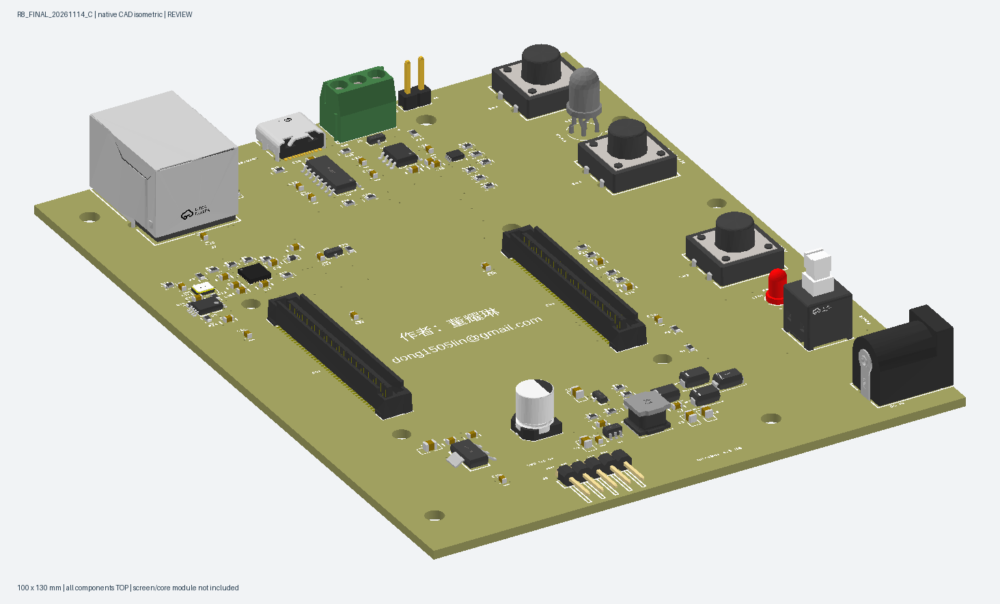

# InfraBot 4.3 底板

[English](README.md) · 简体中文

**R8 工程参考设计。**

面向 **野火 STM32H743 挑战者 V2 核心板**和 **4.3 寸显示屏**的四层底板，为机械臂控制界面提供以太网、CAN 和便于外壳操作的按键与指示灯。

[**原理图 PDF**](docs/schematics/infrabot-pcb-4p3-R8-schematic.pdf) · [可编辑工程](hardware/infrabot_pcb_4p3/infrabot_pcb_4p3.eprj3) · [制造资料](manufacturing/R8/) · [装配指南](docs/assembly.md)



*CAD 预览未安装核心板、屏幕和外壳。库模型用于说明布局，器件尺寸以实际选型为准。*

## 主要特性

- **100 × 130 mm**，名义板厚 1.6 mm，四层 **信号–地–电源–信号（S–G–P–S）**。
- 提供 **以太网/RMII、CAN、USB 转串口和 SWD** 接口。
- **POWER、RESET、STOP、RESUME** 按键，以及电源灯和 RGB 状态灯。
- 元器件全部位于**顶面**，接口与操作件按外壳使用需求布置。
- 显示与触摸通过 **40Pin FPC** 直接连接核心板。
- 提供可编辑原理图/PCB、完整 **105 颗 BOM/CPL**、Gerber，以及自定义 LED2 成形脚封装和模型。

## 硬件资料

当前硬件版本为 **R8**。无需安装 EDA 软件，也可以先阅读 PDF 了解电路。

- [原理图 PDF](docs/schematics/infrabot-pcb-4p3-R8-schematic.pdf)：按功能分区的电路图，带图页书签。
- [嘉立创 EDA 工程](hardware/infrabot_pcb_4p3/infrabot_pcb_4p3.eprj3)：可编辑原理图、PCB 和配置。
- [Gerber ZIP](manufacturing/R8/Gerber.zip)：铜层、阻焊、丝印、钢网、板框与钻孔。
- [物料清单](manufacturing/R8/BOM.csv)与[贴装坐标](manufacturing/R8/CPL.csv)：完整设计清单，未套用个人订单的不贴筛选。
- [LED2 封装和 STEP 模型](hardware/library/)：包含脚位尺寸和模型关联说明。

层序、钻孔文件含义、装配面及工艺要求见[制造说明](manufacturing/R8/README.md)。

## 开始使用

1. 阅读[原理图](docs/schematics/infrabot-pcb-4p3-R8-schematic.pdf)、[接口说明](docs/interfaces.md)和[装配指南](docs/assembly.md)。
2. 克隆或下载完整仓库后，使用**嘉立创 EDA 专业版**打开原生工程。R8 在 **4.1.71** 导出和检查；用其他版本保存前请保留备份。
3. 使用 **Python 3.10+** 运行离线核验：

   ```bash
   python3 -B tools/verify.py
   python3 -B -m unittest discover -s tests -v
   ```

   这些命令仅使用 Python 标准库，检查交付文件哈希、原理图/PCB 引脚网络，以及 BOM/CPL 一致性。
4. 制板前核对所需外部模块和装配事项。修改设计后，按[重新导出流程](docs/reproduce.md)生成对应制造文件。

生成完整的本地发布包：

```bash
python3 -B tools/package_release.py
```

ZIP 和校验值保存在 `.build/`。程序保留已有归档；需要再次打包时可用 `--output` 指定新文件名。

## 兼容性与装配

核心板、屏幕、配套 FPC、电源和固定件需另备。参考显示配置为 **GL043056B0、480 × 272**，实际模块版本和连接器方向须逐一核对。

- **供电：**使用 **6–12 V DC**，不得接入 24 V 电机电源。CAN 工作使用 DC 供电，详见[供电与接线](docs/interfaces.md)。
- **屏幕安装：**以 **16 mm、双内螺纹铜柱**作为装配输入；屏幕、接口和外壳净空仍需实物试装。
- **LED2：**四个焊孔交错布置，**须先成形引脚再插装**。交给工厂时需明确确认这道工序，普通直脚插装不能直接替代。
- **控制按键：**STOP/RESUME 是软件输入；本板没有独立的硬件急停执行链。

本仓库开放底板及配套工具，**不包含固件/SDK、核心板内部设计、屏幕厂商资料包和外壳模型**。原理图与接口文档提供了软件适配所需的硬件连接。

## 验证状态

R8 是**工程参考设计**。记录中的原生 DRC 几何/连接错误为 0；有意的 SW1/LED2 封装匹配提示，以及旧走线的取整容差，均保留说明。

离线核验对照 **105 个器件、338 个已分配引脚网络和 475 个器件焊盘**。它不替代 EDA 几何 DRC、板厂 DFM 或实物测试。引脚成形、模块/外壳配合、温升、整机时序和 EMC 仍需针对实际装配验证。

下单前请阅读[验证范围与已知限制](verification/README.md)。

## 目录结构

```text
hardware/       可编辑工程和自定义 LED2 库文件
manufacturing/  R8 Gerber、BOM、CPL 和文件清单
docs/          原理图 PDF、预览和装配文档
verification/   预期引脚网络及限定范围的检查证据
tools/         离线核验和发布打包工具
tests/         完整性与装配回归测试
```

## 参与改进

欢迎提交可复现的问题、实物验证记录和有依据的改进。报告问题时请注明 PCB 版本、模块型号、供电方式和固件来源。参见[贡献说明](CONTRIBUTING.md)和[版本记录](CHANGELOG.md)。

## 许可

- 作者拥有权利的硬件设计：**[CERN-OHL-P-2.0](LICENSE)**。
- 脚本、测试和 CI：**[MIT](LICENSES/MIT.txt)**。
- 作者编写的文档：**[CC-BY-4.0](LICENSES/CC-BY-4.0.txt)**。

这些许可允许遵守相应条件的商业使用。第三方原有权利和声明继续保留，详见[许可范围](docs/licensing.md)及[第三方来源](THIRD_PARTY.md)。

Copyright © 2026 **YaolinDong（董耀琳）** · [dong1505lin@gmail.com](mailto:dong1505lin@gmail.com)
